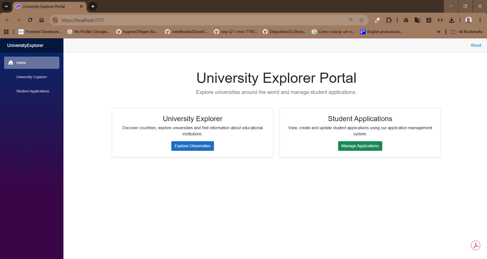
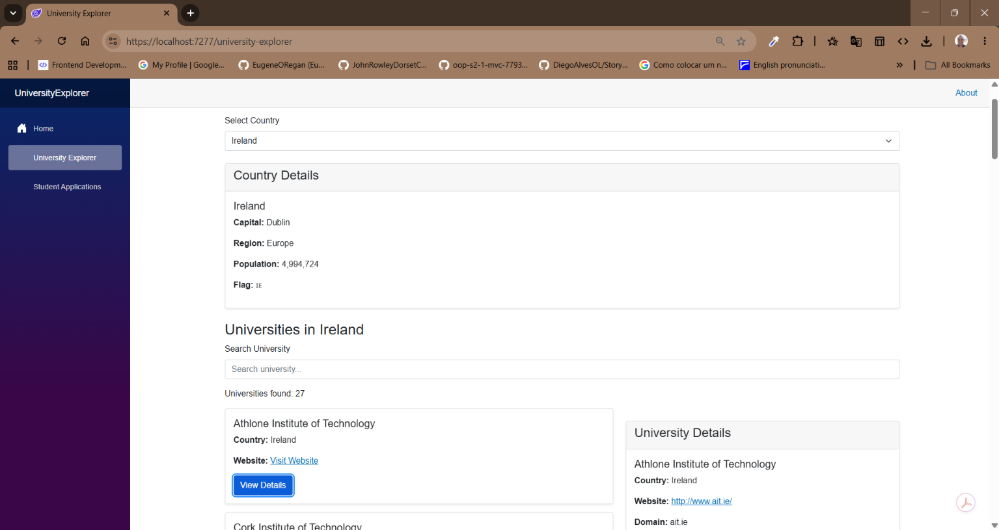
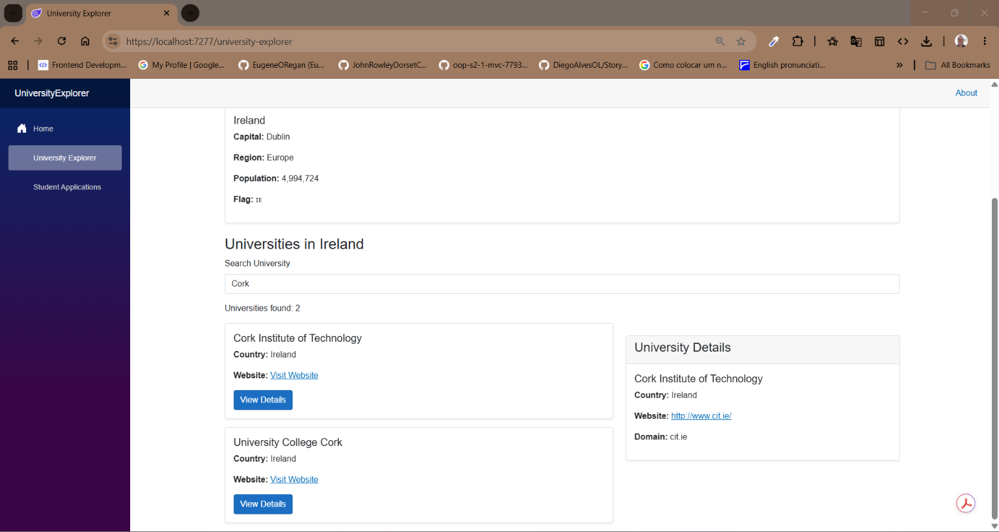
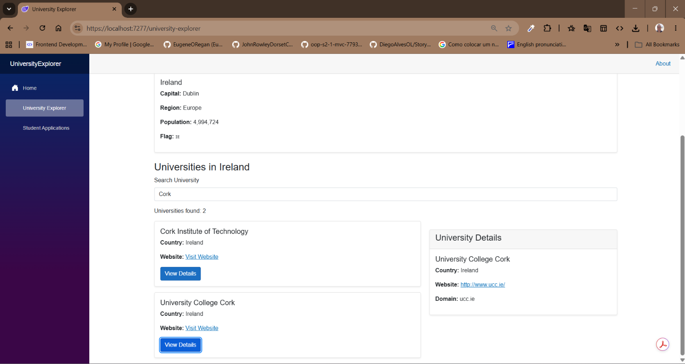
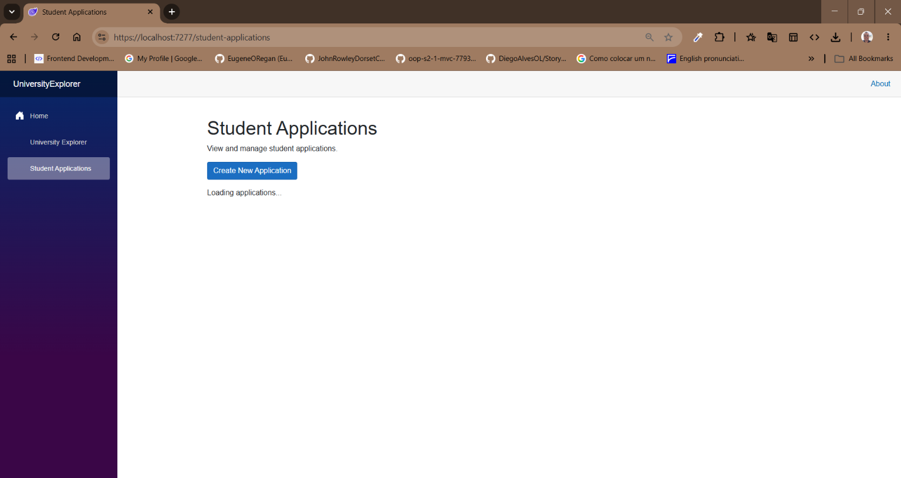
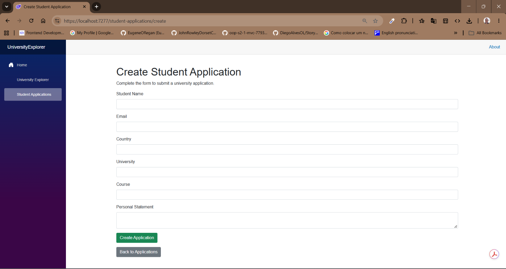
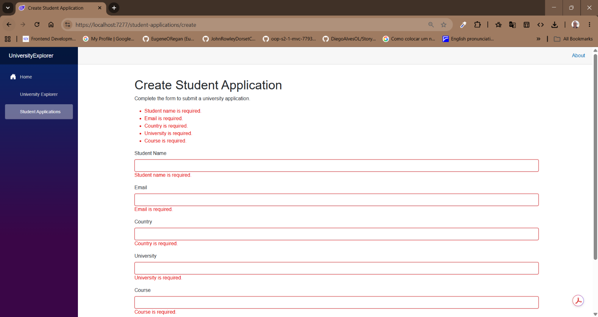
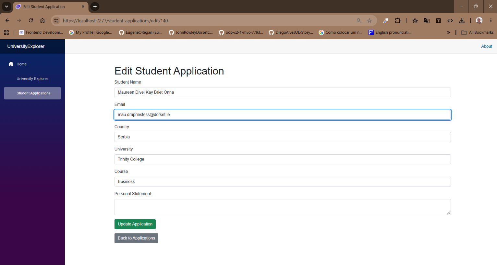
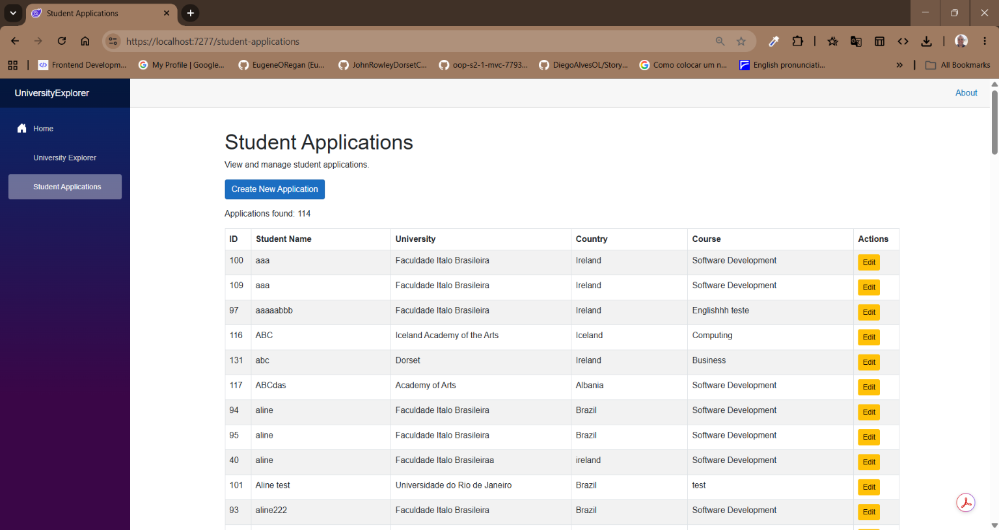

# University Explorer Portal

## Project Overview

University Explorer Portal is a web application developed using
ASP.NET Core Blazor and C#.

The application allows users to explore countries, discover
universities, and manage student applications through REST APIs.

This project was developed for the Full Stack Development CA2 assignment.

## Technologies Used

- C#
- ASP.NET Core Blazor
- Razor Components
- Bootstrap
- REST APIs
- HttpClient
- LINQ
- Dependency Injection
- Data Annotations

## Features

### University Explorer

Users can select a country and view information including:

- Country name
- Capital
- Region
- Population
- Flag information

The application retrieves universities associated with the
selected country.

### University Search

Users can search universities by name using LINQ.

The results update as the user types.

### University Details

Users can select a university and view:

- University name
- Country
- Website
- Domain

The application uses reusable components and EventCallback
for communication between components.

### Student Applications

Users can:

- View existing applications (GET)
- Create new applications (POST)
- Edit existing applications (PUT)

### Form Validation

The application uses EditForm and Data Annotations to validate
user input before submission.

### Error Handling

Loading indicators and error messages are displayed during
API operations.

## Project Structure

- Models: Data classes used by the application.
- Services: Classes responsible for REST API communication.
- Components: Reusable UI components.
- Components/Pages: Main application pages.
- Components/Layout: Navigation and layout components.

## How to Run

1. Clone the repository.
2. Open the solution in Visual Studio.
3. Restore NuGet packages.
4. Build the solution.
5. Run the application using HTTPS.

## Screenshots

The following screenshots demonstrate the main features
of the University Explorer Portal.

### 1. Home Page

### 2. Country Details

### 3. University Search

### 4. University Details

### 5. Student Applications Loading

### 6. Create Student Application

### 7. Form Validation

### 8. Edit Student Application

### 9. Student Applications List
